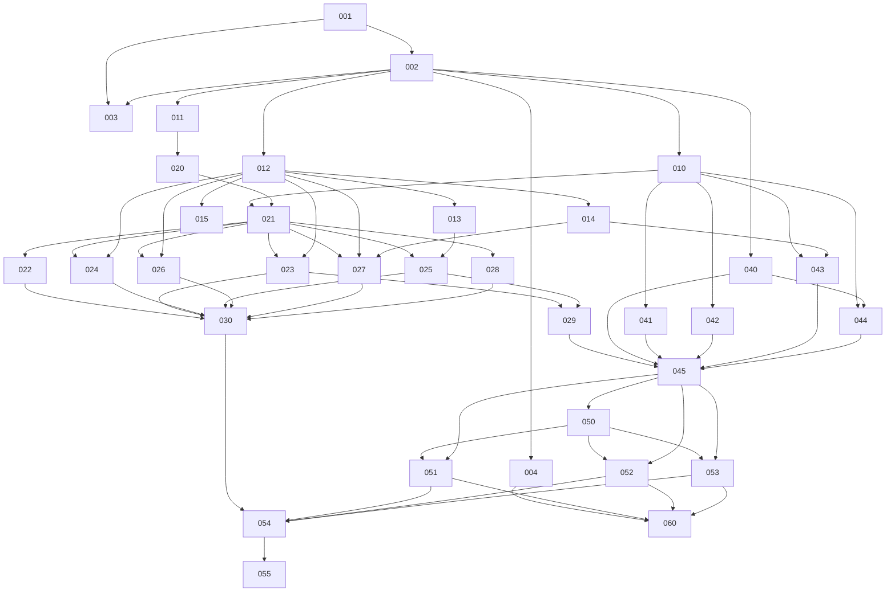

# Fase 1: tarefas (rascunho de planejamento)

**Status do plano: rascunho.** Nenhuma spec está aprovada. As tarefas de
fundação (001 a 004) não dependem de spec e estão prontas para começar, mas
ainda precisam do pedido do Alan para criar estrutura (`CLAUDE.md`, "Estado
atual"). Todas as outras estão **bloqueadas**. Cada uma lista as lacunas que a
bloqueiam.

Escopo da fase 1 (D60, D66): parser + IR + emissor React Native + `Box`, `Text`,
`Pressable` + tema padrão + tipagem estrita. Validação: uma tela do app do Alan
rodando com o alanwind ao lado do NativeWind.

Fora da fase 1 (D66): aviso de contraste (D32), utilitários de acessibilidade
(`tap-target`, `focus-ring`, `motion-safe`: ver perguntas), tema customizável.
Emissor CSS: fase 2 (D60).

## Tarefas

| # | Tarefa | Pacote | Depende de | Status |
|---|---|---|---|---|
| 001 | [Raiz do monorepo e ferramentas](001-raiz-do-monorepo.md) | raiz | — | pronta (sessão principal) |
| 002 | [Esqueleto de `core` e `native`](002-pacotes-core-e-native.md) | core, native | 001 | pronta |
| 003 | [CI mínimo com Knip](003-ci-minimo-com-knip.md) | raiz | 001, 002 | pronta (sessão principal) |
| 004 | [App `playground-expo`](004-playground-expo.md) | playground | 002 | pronta |
| 010 | [Tipos da IR](010-core-tipos-da-ir.md) | core | 002 | bloqueada: `funcionamento-interno.md` |
| 011 | [Diagnósticos](011-core-diagnosticos.md) | core | 002 | bloqueada: `sintaxe.md`, `funcionamento-interno.md` |
| 012 | [Tema: escalas](012-core-tema-escalas.md) | core | 002 | bloqueada: `tema.md` |
| 013 | [Tema: cores](013-core-tema-cores.md) | core | 012 | bloqueada: `tema.md` |
| 014 | [Tema: sombras](014-core-tema-sombras.md) | core | 012 | bloqueada: `tema.md` |
| 015 | [Tema: paleta por tons](015-core-paleta-por-tons.md) | core | 012 | bloqueada: `tema.md` + escopo |
| 020 | [Parser: tokenização e variantes](020-core-parser-tokenizacao.md) | core | 011 | bloqueada: `sintaxe.md` |
| 021 | [Registro do vocabulário e resolução](021-core-registro-do-vocabulario.md) | core | 010, 020 | bloqueada: `sintaxe.md`, `funcionamento-interno.md` |
| 022 | [Vocabulário: layout](022-core-vocabulario-layout.md) | core | 021 | bloqueada: `sintaxe.md` |
| 023 | [Vocabulário: espaçamento](023-core-vocabulario-espacamento.md) | core | 021, 012 | bloqueada: `sintaxe.md`, `tema.md` |
| 024 | [Vocabulário: tamanho](024-core-vocabulario-tamanho.md) | core | 021, 012 | bloqueada: `sintaxe.md`, `tema.md` + escopo |
| 025 | [Vocabulário: cor](025-core-vocabulario-cor.md) | core | 021, 013 | bloqueada: `sintaxe.md`, `tema.md` |
| 026 | [Vocabulário: tipografia](026-core-vocabulario-tipografia.md) | core | 021, 012 | bloqueada: `sintaxe.md`, `tema.md`, `funcionamento-interno.md` |
| 027 | [Vocabulário: borda, raio, sombra](027-core-vocabulario-borda-raio-sombra.md) | core | 021, 012, 014 | bloqueada: `sintaxe.md`, `tema.md` |
| 028 | [Variantes → condições](028-core-variantes.md) | core | 021 | bloqueada: `sintaxe.md`, `funcionamento-interno.md` |
| 029 | [Regra de conflito (D58)](029-core-regra-de-conflito.md) | core (a confirmar) | 023, 025 | bloqueada: `funcionamento-interno.md`, `sintaxe.md` |
| 030 | [Tipagem estrita do `look`](030-core-tipagem-estrita.md) | core | 022 a 028 | bloqueada: `sintaxe.md` |
| 040 | [Contexto: esquema, largura, plataforma](040-native-contexto-de-resolucao.md) | native | 002 | bloqueada: `emissor-native.md`, `tema.md` |
| 041 | [Emissor: layout, espaço, borda](041-native-emissor-layout-espaco-borda.md) | native | 010 | bloqueada: `emissor-native.md`, `funcionamento-interno.md` |
| 042 | [Emissor: cor e tipografia](042-native-emissor-cor-e-texto.md) | native | 010 | bloqueada: `emissor-native.md`, `funcionamento-interno.md` |
| 043 | [Emissor: sombras](043-native-emissor-sombras.md) | native | 010, 014 | bloqueada: `emissor-native.md`, `tema.md` |
| 044 | [Emissor: condições](044-native-condicoes-variantes.md) | native | 010, 040 | bloqueada: `emissor-native.md`, `funcionamento-interno.md` |
| 045 | [Resolução ponta a ponta e cache](045-native-resolucao-e-cache.md) | native | 029, 040 a 044 | bloqueada: `emissor-native.md`, `funcionamento-interno.md`, `sintaxe.md` |
| 050 | [Herança de texto](050-native-heranca-de-texto.md) | native | 045 | bloqueada: `componentes.md` |
| 051 | [`Box`](051-native-componente-box.md) | native | 045, 050 | bloqueada: `componentes.md` |
| 052 | [`Text`](052-native-componente-text.md) | native | 045, 050 | bloqueada: `componentes.md` |
| 053 | [`Pressable`](053-native-componente-pressable.md) | native | 045, 050 | bloqueada: `componentes.md` |
| 054 | [Tipagem da prop `look`](054-native-tipagem-da-prop-look.md) | native | 030, 051, 052, 053 | bloqueada: `componentes.md`, `sintaxe.md` |
| 055 | [Fachada `alanwind`](055-pacote-fachada-alanwind.md) | alanwind | 054 | bloqueada: decisão |
| 060 | [Tela de validação no playground](060-playground-tela-de-validacao.md) | playground | 004, 051, 052, 053 | bloqueada: escolha da tela |

## Grafo de dependências

## Ondas (o que roda em paralelo)

| Onda | Tarefas em paralelo | Observação |
|---|---|---|
| 0 | 001 → 002 → (003 ‖ 004) | Fundação; 001 e 003 são da sessão principal (arquivos de raiz). |
| 1 | 010 ‖ 011 ‖ 012 ‖ 040 | Contratos: IR, diagnósticos, estrutura do tema, contexto RN. |
| 2 | 020 ‖ 013 ‖ 014 ‖ 015 ‖ 041 ‖ 042 ‖ 044 | Com a IR fechada (010), os emissores já podem começar testando com IR escrita à mão. 043 entra assim que 014 terminar. |
| 3 | 021 | Gargalo: estrutura do registro do vocabulário. |
| 4 | 022 ‖ 023 ‖ 024 ‖ 025 ‖ 026 ‖ 027 ‖ 028 ‖ 043 | Cada família num arquivo próprio em `vocabulary/`; sem conflito de arquivo. |
| 5 | 029 ‖ 030 | 029 pode começar assim que 023 e 025 terminarem. |
| 6 | 045 | Junta `core` e emissor. |
| 7 | 050 | Herança de texto. |
| 8 | 051 ‖ 052 ‖ 053 | Componentes. |
| 9 | 054 ‖ 060, depois 055 | Tipos na prop, tela de validação, fachada. |

Caminho crítico: 001 → 002 → 011 → 020 → 021 → 023/025 → 029 → 045 → 050 →
051/052/053 → 060.

## Ordem de aprovação das specs (o que destrava o quê)

Antes de tudo, falta a **lista de classes da fase 1** (não existe
`docs/02-fases.md`). Sem ela, nenhuma tarefa de vocabulário (022 a 028) sabe o
que implementar.

| Ordem | Spec | Destrava (sozinha ou junto das anteriores) | Por quê primeiro |
|---|---|---|---|
| 1 | `funcionamento-interno.md` | 010; com as próximas: 011, 021, 026, 028, 029, 041, 042, 044, 045 | É o contrato entre `core` e `native` (skill `codigo-limpo`). Fechada a IR, `core` e `native` avançam em paralelo. |
| 2 | `sintaxe.md` | 011, 020, 021, 022, 028, 030; com `tema.md`: 023 a 027 | Gramática, códigos de erro e vocabulário. |
| 3 | `tema.md` | 012 a 015; com `sintaxe.md`: 023 a 027; com `emissor-native.md`: 040, 043 | Valores finais das cores e breakpoints. |
| 4 | `emissor-native.md` | 040 a 045 | Tabela de tradução IR → RN e cache. |
| 5 | `componentes.md` | 050 a 054 | Acessibilidade padrão, estados e herança. |
| — | decisões avulsas | 055 (fachada), 060 (tela escolhida), 015 e 024 (escopo) | Não são specs; são perguntas diretas ao Alan. |

`emissor-css.md` não entra na fase 1 (D60).

## Observações para a orquestração

- **Hook do implementador**: ele só escreve em `packages/` e `apps/`. As tarefas
  001 e 003 mexem na raiz (`package.json`, `turbo.json`, `biome.json`,
  `.github/`, `knip.json`), por isso estão marcadas para a sessão principal. Se
  a ideia é treinar o fluxo completo com agentes também na fundação, o hook
  precisa liberar esses arquivos.
- **Testes de componentes RN** (040, 050 a 053) precisam de ferramenta de teste
  de componentes (ex.: `@testing-library/react-native`) e de preset para o
  Vitest. É só ferramenta de dev (D69), mas ainda não foi escolhida.
- **Contraste** (013): o QA calcula a razão WCAG no próprio teste, pela fórmula
  da skill `checar-contraste`, sem depender de função do `core`. Assim nenhum
  código de contraste entra no `core` antes da D32 ser planejada.
