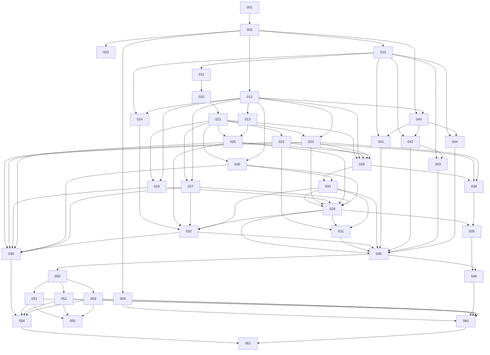

# Fase 1: tarefas

**Status do plano: revisado em 2026-11-26** contra as decisões até a D172.
Todas as specs da fase 1 estão aprovadas e **nenhuma tarefa está bloqueada
por spec**: cada uma está pronta para começar assim que as tarefas da coluna
"Depende de" estiverem na `develop`. Cinco pontos de detalhe ficaram como
pergunta (ver "Perguntas em aberto"); nenhum impede começar, e cada tarefa
afetada diz o que fazer até a resposta.

Se o texto de uma spec diferir de uma tarefa, vale a spec, e o implementador
relata.

Escopo da fase 1 (D60, D66, D77): parser + IR + emissor React Native + `Box`,
`Text`, `Pressable` + tema padrão + tipo do `look` com autocomplete (D126) +
atalhos com `define` e `configure()` (D119) + `look()` e `useLook()` públicos
(D158). Validação: uma cópia do ShadowPlatinum no SDK 58, trocando
`StyleSheet` pelo alanwind (D80).

Fora da fase 1: aviso de contraste (D32, D66); `motion-safe`, `tap-target` e
`focus-ring` (D78); paleta por tons e tema customizável (D99, D118); fachada
`alanwind` (D79, fase 2); `styled()`, `contentLook` e os demais componentes
da D40 (D172); emissor CSS (fase 2, D60).

Node para desenvolver o monorepo: 22.18+ (D150, na `001`); o 22.13+ é o de
quem usa o alanwind.

## Estado das specs

| Spec | Status | Tarefas |
|---|---|---|
| `funcionamento-interno.md` | aprovado | 010 a 035, 041 a 045 |
| `sintaxe.md` | aprovado | 011, 020 a 035 |
| `tema.md` | aprovado | 012 a 014, 025, 032, 040, 046 |
| `emissor-native.md` | aprovado (D152 a D162) | 040 a 046 |
| `componentes.md` | aprovado para a fase 1 (D163 a D172) | 050 a 055, 060 |

`emissor-css.md` não entra na fase 1 (D60). O bloco "Fases posteriores" da
`componentes.md` (`styled()`, demais componentes) não gera tarefa agora
(D172).

## Tarefas

| # | Tarefa | Pacote | Depende de | Status |
|---|---|---|---|---|
| 001 | [Raiz do monorepo e ferramentas](001-raiz-do-monorepo.md) | raiz | — | pronta |
| 002 | [Esqueleto de `core` e `native`](002-pacotes-core-e-native.md) | core, native | 001 | pronta |
| 003 | [Knip no CI](003-ci-minimo-com-knip.md) | raiz | 002 | pronta |
| 004 | [App `playground-expo`](004-playground-expo.md) | playground | 002 | pronta |
| 010 | [Tipos da IR](010-core-tipos-da-ir.md) | core | 002 | pronta |
| 011 | [Catálogo de diagnósticos](011-core-diagnosticos.md) | core | 010 | pronta |
| 012 | [Tema: escalas e breakpoints](012-core-tema-escalas.md) | core | 002 | pronta |
| 013 | [Tema: cores](013-core-tema-cores.md) | core | 012 | pronta |
| 014 | [Tema: sombras e elevação](014-core-tema-sombras.md) | core | 010, 012 | pronta |
| 020 | [Parser](020-core-parser-tokenizacao.md) | core | 011 | pronta |
| 021 | [Registro do vocabulário e resolução](021-core-registro-do-vocabulario.md) | core | 020 | pronta |
| 022 | [Vocabulário: layout](022-core-vocabulario-layout.md) | core | 021 | pronta |
| 023 | [Vocabulário: espaçamento](023-core-vocabulario-espacamento.md) | core | 021, 012 | pronta |
| 024 | [Vocabulário: tamanho](024-core-vocabulario-tamanho.md) | core | 021, 012 | pronta |
| 025 | [Vocabulário: cor](025-core-vocabulario-cor.md) | core | 021, 013 | pronta |
| 026 | [Vocabulário: tipografia](026-core-vocabulario-tipografia.md) | core | 021, 012 | pronta |
| 027 | [Vocabulário: borda, raio, opacidade](027-core-vocabulario-borda-raio-sombra.md) | core | 021, 012 | pronta |
| 028 | [Variantes → condições](028-core-variantes.md) | core | 021, 012, 022, 023, 025 | pronta |
| 029 | [Regra de conflito](029-core-regra-de-conflito.md) | core | 033, 023 a 027 | pronta |
| 030 | [Tipo do `look` com autocomplete](030-core-tipagem-estrita.md) | core | 022 a 027, 032 | pronta |
| 031 | [Alinhamento pela direção](031-core-alinhamento-e-direcao.md) | core | 022, 029, 033 | pronta |
| 032 | [`shadow-*` e elevação no escuro](032-core-sombra-e-elevacao.md) | core | 014, 025, 027, 029, 033 | pronta |
| 033 | [Camadas e precedência](033-core-camadas-e-precedencia.md) | core | 028, 026 | pronta |
| 034 | [Atalhos: validação](034-core-atalhos-validacao.md) | core | 028, 022, 023 | pronta |
| 035 | [Atalhos: expansão](035-core-atalhos-expansao.md) | core | 029, 034 | pronta |
| 040 | [Contexto: esquema, faixa, plataforma, janela](040-native-contexto-de-resolucao.md) | native | 002, 012 | pronta |
| 041 | [Emissor: layout, espaço, borda, raio](041-native-emissor-layout-espaco-borda.md) | native | 010, 040 | pronta |
| 042 | [Emissor: cor e tipografia](042-native-emissor-cor-e-texto.md) | native | 010, 040 | pronta |
| 043 | [Emissor: `boxShadow`](043-native-emissor-sombras.md) | native | 010, 042 | pronta |
| 044 | [Emissor: condições e camadas](044-native-condicoes-variantes.md) | native | 010, 040 | pronta |
| 045 | [Resolução, cache, `look()` e `useLook()`](045-native-resolucao-e-cache.md) | native | 022 a 029, 031 a 033, 040 a 044 | pronta |
| 046 | [`defineConfig` e `configure()`](046-native-configure-e-define-config.md) | native | 035, 045 | pronta |
| 050 | [Herança de texto](050-native-heranca-de-texto.md) | native | 045 | pronta |
| 051 | [`Box`](051-native-componente-box.md) | native | 045, 050 | pronta |
| 052 | [`Text`](052-native-componente-text.md) | native | 045, 050 | pronta |
| 053 | [`Pressable`](053-native-componente-pressable.md) | native | 045, 050 | pronta |
| 054 | [Tipo do `look` nos componentes e na API](054-native-tipagem-da-prop-look.md) | native | 030, 051, 052, 053 | pronta |
| 055 | [Árvores de componentes (integração)](055-native-componentes-integracao.md) | native | 051, 052, 053 | pronta |
| 060 | [Tela de demonstração no playground](060-playground-tela-de-validacao.md) | playground | 004, 046, 051, 052, 053 | pronta |
| 061 | [Validação no ShadowPlatinum](061-validacao-no-shadowplatinum.md) | fora do repo | 054, 060 | pronta (telas escolhidas pelo Alan, D147) |

"Pronta" = pode começar assim que as tarefas da coluna "Depende de"
estiverem na `develop`.

## O que mudou nesta revisão

As tarefas do `native` e dos componentes saíram de "bloqueada": as lacunas
de cada uma viraram regras das specs aprovadas (D152 a D172).

**Criada**:

- **055** árvores de componentes com herança: as onze linhas da seção 5.3 da
  `componentes.md` precisam de `Box`, `Pressable` e `Text` juntos, e nenhuma
  das tarefas 050 a 053 consegue testá-las sozinha. O número estava livre
  desde a remoção da fachada.

**Mudanças nas tarefas**:

- **040**: faixa com os limites lidos do tema (D153); janela no contexto
  (D152); `setColorScheme` com estado próprio, sem `Appearance` (D162);
  instantâneo e hook de contexto para `look()` e `useLook()`; define os
  tipos `ResolutionContext` e `ScreenBand`.
- **041**: tabela da R16 (`Percent` como `'50%'`, `ScreenSize` pela janela,
  D152); `flexDirection` padrão do `Box` passou para a `051` (D168). Passa a
  depender da `040` (tipo do contexto).
- **042**: cor com alfa em `rgba(...)` e `fontWeight` como string (D154);
  `fontFamily` exata (D156); `lineHeight` a duas casas, recebendo o tamanho
  final de quem chama (D157); sem mexer na escala de fonte. Passa a depender
  da `040`.
- **043**: `boxShadow` como lista de objetos (D155), com a conversão de cor
  da `042` (passa a depender dela).
- **044**: forma da entrada (`ResolutionContext` e `InteractionStates`, seção
  4) e da saída; define `InteractionStates`; props aplicadas como estilo
  (R23).
- **045**: `look()` e `useLook()` públicos (D158); janela exata na chave
  para unidades de tela (D152); estados por entrada do cache e limite 500
  (D159); aviso com `__DEV__` e `console.warn`, um por `look`, código e
  posição (D160); resolução interna com `lineHeight` em `Ratio` e opção
  "sem estados" para o aviso da D166.
- **046**: aviso de ausência só com `AW101` (D161); segunda chamada
  substitui; chave estranha ignorada com aviso.
- **050**: lista exata das herdáveis, sem `numberOfLines` (D163); `Text`
  também repassa (D164); texto de variante de estado do pai (D165);
  `lineHeight` herdado como `Ratio`.
- **051**: base `flexDirection: 'column'` (D168); variantes de estado com
  aviso (D166); `style` não normalizado (D167).
- **052**: precedência por propriedade e `lineHeight` sobre o tamanho final
  (R20, D157); `Text` dentro de `Text` (D164); aviso de variante de estado
  (D166).
- **053**: estados e callbacks (R22, R23); `hitSlop` só depois do
  `onLayout` e o da pessoa vence (D170); foco só por `onFocus`/`onBlur`
  (D171); outline do navegador mantido (D169); `role` também desliga o
  papel padrão.
- **054**: o tipo vale também para `look()` e `useLook()` (D158).
- **060**: deixou de estar bloqueada.

## Grafo de dependências

O grafo omite as arestas implícitas (ex.: 045 também depende de 022 a 027,
que já chegam por 029).

## Ondas (o que roda em paralelo)

| Onda | Tarefas em paralelo | Observação |
|---|---|---|
| 0 | 001 → 002 → (003 ‖ 004) | Fundação. |
| 1 | 010 ‖ 012 | Contratos: IR e escalas do tema. |
| 2 | 011 ‖ 013 ‖ 014 ‖ 040 | A 040 fecha os tipos do contexto para os emissores. |
| 3 | 020 ‖ 041 ‖ 042 ‖ 044 | Parser; emissores testam com IR escrita à mão. |
| 4 | 021 ‖ 043 | Gargalo do `core`; a sombra usa a cor da 042. |
| 5 | 022 ‖ 023 ‖ 024 ‖ 025 ‖ 026 ‖ 027 | Cada família num arquivo próprio em `vocabulary/`. |
| 6 | 028 | Variantes; começa assim que 022, 023 e 025 terminarem. |
| 7 | 033 ‖ 034 | Camadas; validação dos atalhos. |
| 8 | 029 | Conflito. |
| 9 | 031 ‖ 032 ‖ 035 | Alinhamento, elevação, expansão dos atalhos. |
| 10 | 030 ‖ 045 | Tipo do `look`; junção de `core` e emissor. |
| 11 | 046 ‖ 050 | `configure`; herança de texto. |
| 12 | 051 ‖ 052 ‖ 053 | Componentes. |
| 13 | 054 ‖ 055 ‖ 060 | Tipos; árvores de componentes; tela de demonstração. |
| 14 | 061 | Validação no ShadowPlatinum. |

Caminho crítico: 001 → 002 → 010 → 011 → 020 → 021 → 022/023/025 → 028 →
033 → 029 → 031/032 → 045 → 050 → 051/052/053 → 060 → 061.

## Perguntas em aberto

Nenhuma bloqueia o início; as tarefas afetadas dizem o que fazer até a
resposta.

1. **`leading-*` sem `type-*` fora dos componentes** (`045`): em
   `look('leading-normal')` ou `useLook('leading-normal')`, qual tamanho
   entra na conta? A R20 da `emissor-native.md` fala do "tamanho final do
   texto, depois da herança e do padrão do `Text`", mas `look()` não tem
   herança. Opções: 16 (padrão do `Text`, D112), ou não gerar `lineHeight`
   sem `fontSize` no mesmo `look`. Até a resposta, o QA não testa esse
   caso.
2. **Classes de texto no estilo do próprio `Box` e `Pressable`** (`051`,
   `053`): `<Box look="text-muted">` põe `color` no `style` do `View` além
   de repassar pelo contexto, ou só repassa? A spec não diz, e o `View` do
   RN não usa essas propriedades.
3. **Onde fica o aviso da D167** (`style={{ padding }}` não vence o lado do
   `look`): a R2 da `componentes.md` diz "a documentação DEVE avisar", mas o
   site é da fase 5 e nenhuma tarefa da fase 1 escreve documentação de uso.
   README do `@alanwind/native`, JSDoc da prop, ou fica para o site?
4. **Repetição do aviso da D166** (variante de estado em `Box` e `Text`,
   sem código `AW`): a D160 deduplica por `look`, código e posição. Sem
   código, a chave é `look` + posição da variante? Até a resposta, o QA só
   confere que há aviso em dev e nenhum em produção.
5. **Nomes exportados dos tipos das props** (`054`): a seção 4 da
   `componentes.md` deixa para a tarefa, mas é API pública e `TextProps` e
   `PressableProps` colidem com os do RN. Até a resposta, os tipos ficam
   internos.

## Observações para a orquestração

- **Hook do implementador** (D148): além de `packages/` e `apps/`, ele edita
  `package.json`, `pnpm-lock.yaml`, `pnpm-workspace.yaml`, `turbo.json`,
  `biome.json`, `tsconfig*.json` e `knip.json` da raiz. `.gitignore`,
  `.npmrc` e `.github/` continuam com a sessão principal (ver 001). A 061 é
  fora do repositório.
- **CI** (D141): assim que o `pnpm-lock.yaml` entra na `develop` (001), o job
  `Code` passa a rodar `biome ci`, `typecheck`, `test` e `build` em toda PR; o
  passo do Knip liga quando existir `knip.json` (003).
- **Testes**: Vitest no `core` e nos emissores; Jest com `jest-expo` nos
  componentes e hooks do `native` (D114, ADR 0003). Convenção na 002:
  `.test.ts` no Vitest, `.test.tsx` no Jest. A 045 tem as duas: `look()`
  com contexto explícito no Vitest, `useLook()` no Jest.
- **`emit/index.ts`**: 041, 042, 043 e 044 editam o mesmo arquivo; ao
  integrar uma depois da outra, a sessão principal resolve o conflito de
  merge.
- **Notação da `sintaxe.md`**: a seção 7 usa propriedades abstratas
  (`pad.left=16`, `role(primary)`). O QA traduz cada linha para a IR da
  `funcionamento-interno.md`, com os valores do `tema.md`.
- **Contraste** (013): o QA calcula a razão WCAG no próprio teste, pela
  fórmula da skill `checar-contraste`, sem função do `core` (o aviso de
  contraste, D32, não é da fase 1).
