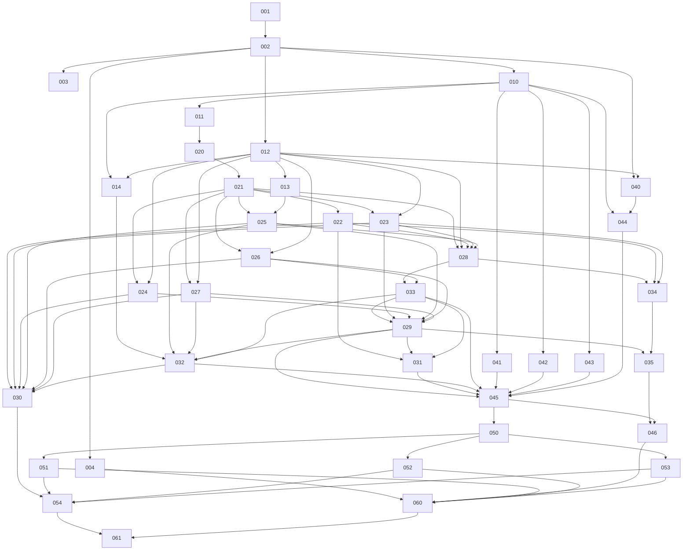

# Fase 1: tarefas

**Status do plano: revisado em 2026-11-26** contra as decisões até a D143 e
as specs `sintaxe.md`, `funcionamento-interno.md` e `tema.md` **aprovadas**.
A fundação (001 a 004) e quase todo o `core` estão prontos para começar,
respeitando as dependências entre tarefas; a fundação ainda precisa do pedido
do Alan para criar estrutura (`CLAUDE.md`, "Estado atual"). Duas tarefas do
`core` (029, 034) esperam resposta a uma pergunta; quatro (011, 026, 028, 032)
estão prontas com uma ressalva pontual. O `native` e os componentes seguem
**bloqueados** por `emissor-native.md` e `componentes.md`, ainda em
rascunho.

Escopo da fase 1 (D60, D66, D77): parser + IR + emissor React Native + `Box`,
`Text`, `Pressable` + tema padrão + tipo do `look` com autocomplete (D126) +
atalhos com `define` e `configure()` (D119). Validação: uma cópia do
ShadowPlatinum no SDK 58, trocando `StyleSheet` pelo alanwind (D80).

Fora da fase 1: aviso de contraste (D32, D66); `motion-safe`, `tap-target` e
`focus-ring` (D78); paleta por tons e tema customizável (D99, D118); fachada
`alanwind` (D79, fase 2); `styled()` e os demais componentes da D40; emissor
CSS (fase 2, D60).

## Estado das specs

| Spec | Status | Tarefas que ainda espera |
|---|---|---|
| `funcionamento-interno.md` | aprovado | — |
| `sintaxe.md` | aprovado | — |
| `tema.md` | aprovado | — |
| `emissor-native.md` | rascunho (seção 2 aberta) | 040 a 046, 053 |
| `componentes.md` | rascunho (seção 2 aberta) | 050 a 054 |

`emissor-css.md` não entra na fase 1 (D60).

## Tarefas

| # | Tarefa | Pacote | Depende de | Status |
|---|---|---|---|---|
| 001 | [Raiz do monorepo e ferramentas](001-raiz-do-monorepo.md) | raiz | — | pronta (sessão principal) |
| 002 | [Esqueleto de `core` e `native`](002-pacotes-core-e-native.md) | core, native | 001 | pronta |
| 003 | [Knip no CI](003-ci-minimo-com-knip.md) | raiz | 002 | pronta (sessão principal) |
| 004 | [App `playground-expo`](004-playground-expo.md) | playground | 002 | pronta |
| 010 | [Tipos da IR](010-core-tipos-da-ir.md) | core | 002 | pronta |
| 011 | [Catálogo de diagnósticos](011-core-diagnosticos.md) | core | 010 | pronta, com ressalva (empate, `AW303`) |
| 012 | [Tema: escalas e breakpoints](012-core-tema-escalas.md) | core | 002 | pronta |
| 013 | [Tema: cores](013-core-tema-cores.md) | core | 012 | pronta |
| 014 | [Tema: sombras e elevação](014-core-tema-sombras.md) | core | 010, 012 | pronta |
| 020 | [Parser](020-core-parser-tokenizacao.md) | core | 011 | pronta |
| 021 | [Registro do vocabulário e resolução](021-core-registro-do-vocabulario.md) | core | 020 | pronta |
| 022 | [Vocabulário: layout](022-core-vocabulario-layout.md) | core | 021 | pronta |
| 023 | [Vocabulário: espaçamento](023-core-vocabulario-espacamento.md) | core | 021, 012 | pronta |
| 024 | [Vocabulário: tamanho](024-core-vocabulario-tamanho.md) | core | 021, 012 | pronta |
| 025 | [Vocabulário: cor](025-core-vocabulario-cor.md) | core | 021, 013 | pronta |
| 026 | [Vocabulário: tipografia](026-core-vocabulario-tipografia.md) | core | 021, 012 | pronta, com ressalva (`lines-0`) |
| 027 | [Vocabulário: borda, raio, opacidade](027-core-vocabulario-borda-raio-sombra.md) | core | 021, 012 | pronta |
| 028 | [Variantes → condições](028-core-variantes.md) | core | 021, 012, 022, 023, 025 | pronta, com ressalva (`sintaxe.md` 7.3) |
| 029 | [Regra de conflito](029-core-regra-de-conflito.md) | core | 033, 023 a 027 | bloqueada: pergunta (camadas com a mesma condição) |
| 030 | [Tipo do `look` com autocomplete](030-core-tipagem-estrita.md) | core | 022 a 027, 032 | pronta |
| 031 | [Alinhamento pela direção](031-core-alinhamento-e-direcao.md) | core | 022, 029, 033 | pronta |
| 032 | [`shadow-*` e elevação no escuro](032-core-sombra-e-elevacao.md) | core | 014, 025, 027, 029, 033 | pronta, com ressalva (sombra em variante) |
| 033 | [Camadas e precedência](033-core-camadas-e-precedencia.md) | core | 028, 026 | pronta |
| 034 | [Atalhos: validação](034-core-atalhos-validacao.md) | core | 028, 022, 023 | bloqueada: pergunta (diagnóstico de carregamento) |
| 035 | [Atalhos: expansão](035-core-atalhos-expansao.md) | core | 029, 034 | pronta |
| 040 | [Contexto: esquema, faixa, plataforma](040-native-contexto-de-resolucao.md) | native | 002, 012 | bloqueada: `emissor-native.md` |
| 041 | [Emissor: layout, espaço, borda, raio](041-native-emissor-layout-espaco-borda.md) | native | 010 | bloqueada: `emissor-native.md` |
| 042 | [Emissor: cor e tipografia](042-native-emissor-cor-e-texto.md) | native | 010 | bloqueada: `emissor-native.md` |
| 043 | [Emissor: `boxShadow`](043-native-emissor-sombras.md) | native | 010 | bloqueada: `emissor-native.md` |
| 044 | [Emissor: condições e camadas](044-native-condicoes-variantes.md) | native | 010, 040 | bloqueada: `emissor-native.md` |
| 045 | [Resolução ponta a ponta e cache](045-native-resolucao-e-cache.md) | native | 022 a 029, 031 a 033, 040 a 044 | bloqueada: `emissor-native.md` |
| 046 | [`defineConfig` e `configure()`](046-native-configure-e-define-config.md) | native | 035, 045 | bloqueada: `emissor-native.md` |
| 050 | [Herança de texto](050-native-heranca-de-texto.md) | native | 045 | bloqueada: `componentes.md` |
| 051 | [`Box`](051-native-componente-box.md) | native | 045, 050 | bloqueada: `componentes.md` |
| 052 | [`Text`](052-native-componente-text.md) | native | 045, 050 | bloqueada: `componentes.md` |
| 053 | [`Pressable`](053-native-componente-pressable.md) | native | 045, 050 | bloqueada: `componentes.md` |
| 054 | [Tipo da prop `look`](054-native-tipagem-da-prop-look.md) | native | 030, 051, 052, 053 | bloqueada: `componentes.md` |
| 060 | [Tela de demonstração no playground](060-playground-tela-de-validacao.md) | playground | 004, 046, 051, 052, 053 | bloqueada: tarefas anteriores |
| 061 | [Validação no ShadowPlatinum](061-validacao-no-shadowplatinum.md) | fora do repo | 054, 060 | bloqueada: decisões |

"Pronta" = pode começar assim que as tarefas da coluna "Depende de"
estiverem na `develop`. "Com ressalva" = um caso isolado aguarda resposta; a
tarefa diz o que fazer se a resposta não vier antes.

## O que mudou nesta revisão

**Removidas** (os arquivos ficaram com uma nota e devem ser apagados):

- **015** (paleta por tons): fora da fase 1. A paleta e o tom no valor livre
  (`bg=red-40`) ficaram para a fase de tema (D99, D118); `bg=red-40` dá
  `AW008` (D138), coberto pela 020.
- **055** (fachada `alanwind`): fica para a fase 2 (D79).

**Criadas**:

- **031** alinhamento pela direção final (R22 a R26, R45, R46 da
  `funcionamento-interno.md`), separado da 022 por depender de condições e
  camadas.
- **032** `shadow-*` e elevação no escuro (R34, R35, D137), tirada da 027 pelo
  mesmo motivo.
- **033** camadas e precedência entre condições (R15, R16, R28; D136, D140).
- **034** e **035** atalhos: validação ao carregar (`AW301`, `AW302`,
  `AW304`) e expansão no `look` com `origin` (D101, D134, D135). Nenhuma
  tarefa cobria os atalhos, que são da fase 1 (D77).
- **046** `defineConfig` e `configure()` no `native` (D119).
- **061** validação no ShadowPlatinum (D80), fora deste repositório.

**Mudanças de escopo maiores**:

- 001 cria `packageManager` e os scripts `typecheck`, `test`, `build` com os
  nomes que o CI e o Release chamam (D141, D142); 003 encolheu para o Knip (o
  workflow já existe); 002 prepara o Jest do `native` (D114) e os pacotes
  para o Release.
- 011 passou a depender da 010 (o tipo `Diagnostic` está na IR).
- 027 virou "espessura de borda, raio e opacidade" (a opacidade do elemento
  não tinha tarefa).
- 030 e 054: o tipo do `look` é autocomplete + `string` (D126), sem erro de
  tipo para classe inválida.
- 043 encolheu: só traduz `boxShadow` (D108); a elevação é do `core` (032).
- 060 deixou de ser "a tela do app do Alan" e virou uma tela de demonstração
  no playground; a validação real é a 061 (D80).

## Grafo de dependências

O grafo omite as arestas implícitas (ex.: 045 também depende de 022 a 027,
que já chegam por 029).

## Ondas (o que roda em paralelo)

| Onda | Tarefas em paralelo | Observação |
|---|---|---|
| 0 | 001 → 002 → (003 ‖ 004) | Fundação; 001 e 003 são da sessão principal. |
| 1 | 010 ‖ 012 | Contratos: IR e escalas do tema. |
| 2 | 011 ‖ 013 ‖ 014 ‖ 040 ‖ 041 ‖ 042 ‖ 043 | Com a IR fechada, os emissores testam com IR escrita à mão. |
| 3 | 020 ‖ 044 | Parser; condições no emissor (depois da 040). |
| 4 | 021 | Gargalo: estrutura do registro e resolução. |
| 5 | 022 ‖ 023 ‖ 024 ‖ 025 ‖ 026 ‖ 027 | Cada família num arquivo próprio em `vocabulary/`. |
| 6 | 028 | Variantes; começa assim que 022, 023 e 025 terminarem. |
| 7 | 033 ‖ 034 | Camadas; validação dos atalhos. |
| 8 | 029 | Conflito. |
| 9 | 031 ‖ 032 ‖ 035 | Alinhamento, elevação, expansão dos atalhos. |
| 10 | 030 ‖ 045 | Tipo do `look`; junção de `core` e emissor. |
| 11 | 046 ‖ 050 | `configure`; herança de texto. |
| 12 | 051 ‖ 052 ‖ 053 | Componentes. |
| 13 | 054 ‖ 060 | Tipo na prop; tela de demonstração. |
| 14 | 061 | Validação no ShadowPlatinum. |

Caminho crítico: 001 → 002 → 010 → 011 → 020 → 021 → 022/023/025 → 028 →
033 → 029 → 031/032 → 045 → 050 → 051/052/053 → 060 → 061.

## Perguntas em aberto (lacunas reais nas specs)

Cada uma está detalhada na tarefa citada.

- Ordem dos diagnósticos no empate de posição: R39 da
  `funcionamento-interno.md` × R49 da `sintaxe.md` (011).
- `AW303` no catálogo da fase 1 sem caso que o provoque (011).
- `lines-0`: qual código (026).
- `dark(light(x))`: a seção 7.3 da `sintaxe.md` mostra a declaração, a D138
  descarta (028).
- Especificidade e empate entre camadas com a mesma condição (029).
- `shadow-*` dentro de variante e o `bg-*` "já escrito" noutra condição (032).
- Forma (`position`) dos diagnósticos de carregamento e destino do atalho
  após `AW302`/`AW304` (034).
- `emissor-native.md` e `componentes.md` ainda têm seção 2 aberta; as
  lacunas que travam 040 a 046 e 050 a 053 estão listadas em cada tarefa.
- Telas e forma de consumo do alanwind na cópia do ShadowPlatinum (061).

## Observações para a orquestração

- **Hook do implementador**: ele só escreve em `packages/` e `apps/`. As
  tarefas 001 e 003 mexem na raiz (`package.json`, `turbo.json`,
  `biome.json`, `knip.json`), por isso estão marcadas para a sessão
  principal. A 061 é fora do repositório.
- **CI** (D141): assim que o `pnpm-lock.yaml` entra na `develop` (001), o job
  `Code` passa a rodar `biome ci`, `typecheck`, `test` e `build` em toda PR; o
  passo do Knip liga quando existir `knip.json` (003).
- **Testes**: Vitest no `core` e nos emissores; Jest com `jest-expo` nos
  componentes e hooks do `native` (D114, ADR 0003). Convenção na 002:
  `.test.ts` no Vitest, `.test.tsx` no Jest.
- **Notação da `sintaxe.md`**: a seção 7 usa propriedades abstratas
  (`pad.left=16`, `role(primary)`). O QA traduz cada linha para a IR da
  `funcionamento-interno.md`, com os valores do `tema.md`.
- **Contraste** (013): o QA calcula a razão WCAG no próprio teste, pela
  fórmula da skill `checar-contraste`, sem função do `core` (o aviso de
  contraste, D32, não é da fase 1).
